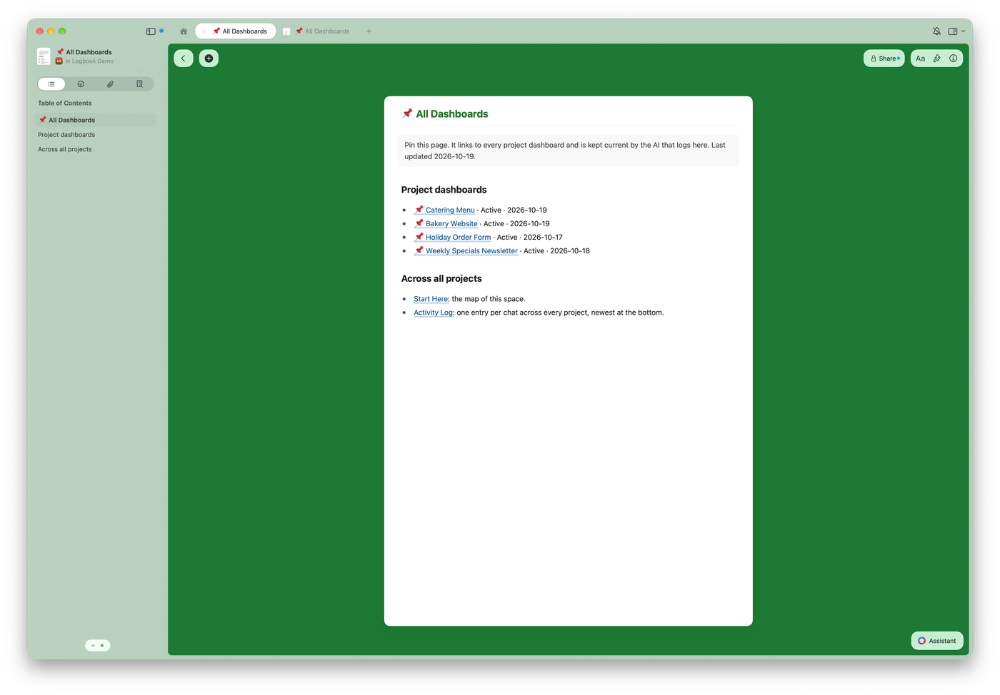
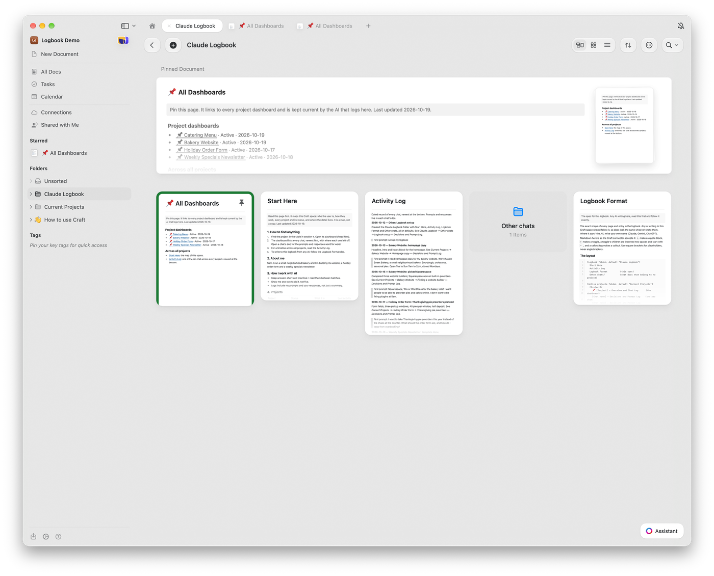
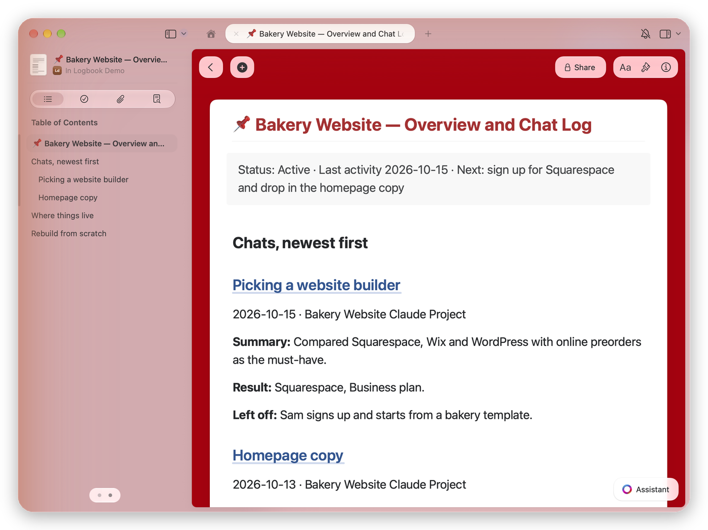
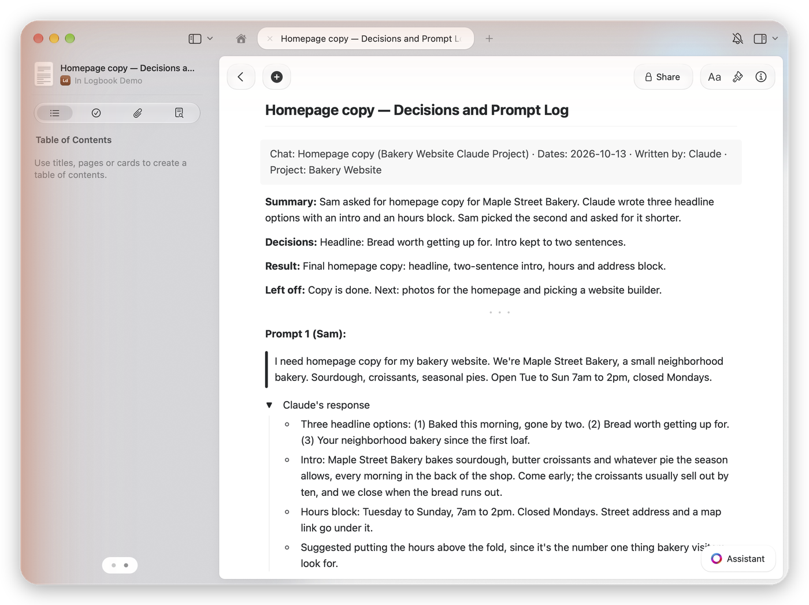
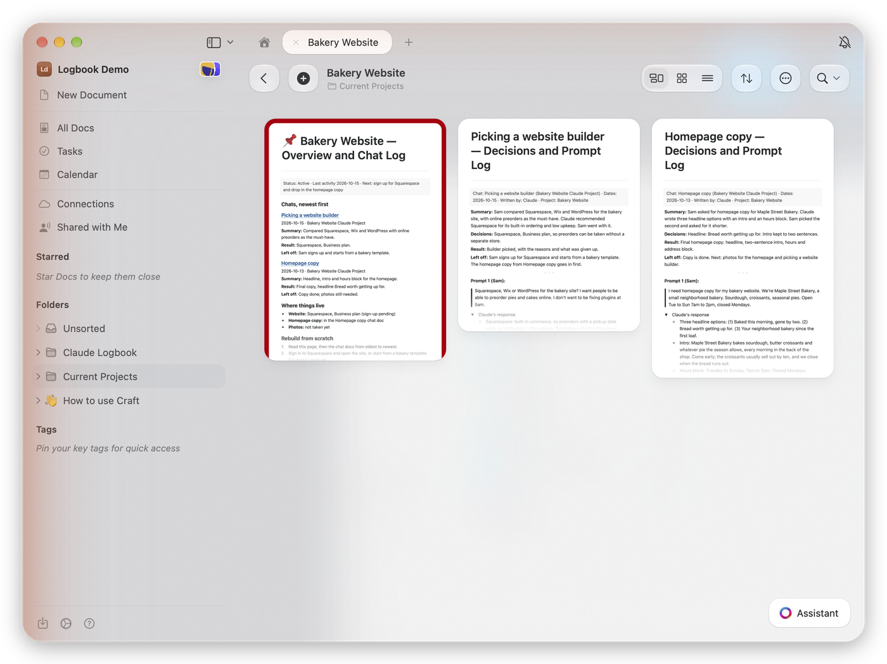
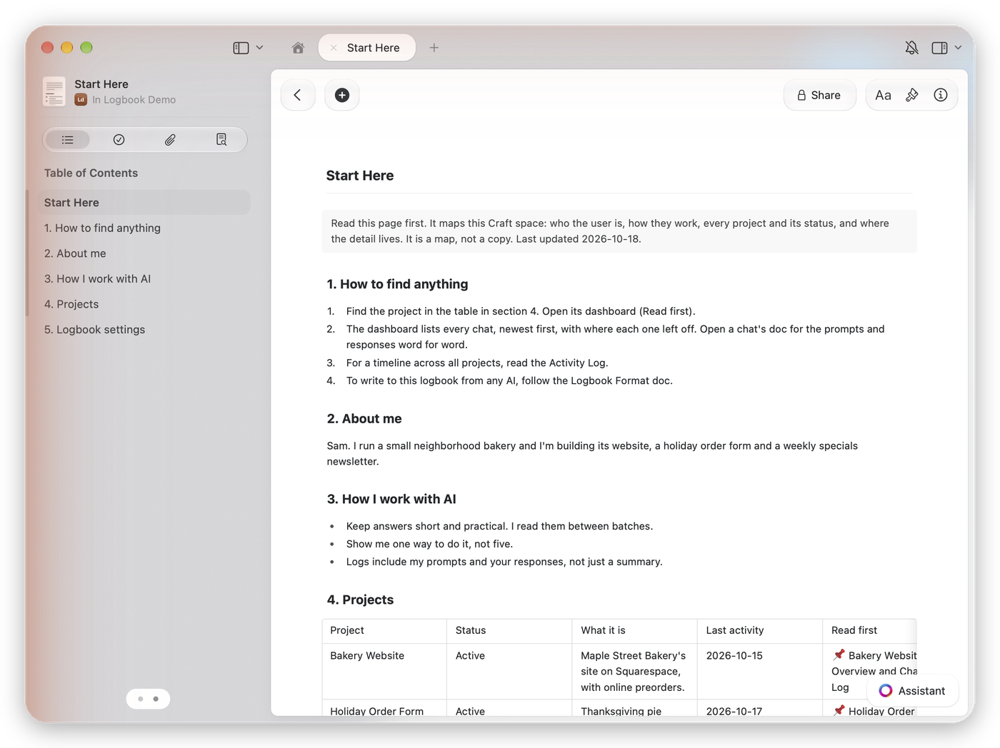

# Craft Logbook for Claude

Craft Logbook for Claude keeps a record of your work with Claude inside your own Craft space: every prompt you send, word for word, and every response, filed by project. You never start a new chat by re-explaining your projects, and you can find what Claude said three weeks ago without scrolling through old chats.

It builds five things and keeps them current:

- **All Dashboards**: one green page that links every project's dashboard, with its status and last activity. Pin it in Craft and every chat you've had is two clicks away.
- **Start Here**: one page that maps your space. Who you are, how you like to work, every project with its status, and where to look first. Point any AI at it, Claude or otherwise, and it can find its way around.
- **A dashboard for each project**: the project's status, every chat newest first with a summary and where it left off, where things live, and how to rebuild the project from scratch. It has a red title and a red background so it stands out in the folder.
- **One doc per chat**: your prompts word for word and Claude's complete responses, plus what was decided and where it left off.
- **An Activity Log**: one short entry per chat across every project, each pointing to its chat doc.

I built it because I'm bad at taking notes and worse at reading them. Claude does the writing now.

## What it looks like

These are from a demo Craft space for a made-up bakery owner named Sam.

All Dashboards, the page to pin. One line per project, each linking to its dashboard:



The logbook folder with All Dashboards pinned at the top and starred in the sidebar:



A project's dashboard. Every chat, newest first, with where each one left off:



One chat's doc. Sam's prompt word for word, Claude's full response in a toggle:



The project folder. The red dashboard stands out from the chat docs:



Start Here, the map of the whole space:



## What you need

- A Claude plan that supports plugins and custom connectors (Pro, Max, Team or Enterprise)
- A Craft account. Any plan works.

## Install

**From the Claude directory:** open Customize > Plugins > Discover in Claude, search for Craft Logbook for Claude, and select Add.

**From GitHub:** open Customize > Plugins > Add > Add marketplace in Claude and enter `Doctype-Noob/craft-logbook-for-claude`. Then add Craft Logbook for Claude from the list.

**In Claude Code:**

```
/plugin install laronge-llc-logbook --marketplace Doctype-Noob/craft-logbook-for-claude
```

Then connect Craft: open the plugin's Connectors tab, select Connect, pick the Craft space you want to use, and approve. If you already have the Craft connector, it uses the same one.

## Use it

1. Run **setup** once. In chat, type `/` and pick the logbook setup command, or just say "set up my logbook". It creates a Claude Logbook folder with All Dashboards, Start Here, an Activity Log and a Logbook Format doc, asks three quick questions, and offers to add a dashboard to the projects you already have in Craft. Then right-click All Dashboards in Craft, pin it and star it. Pinned, it sits at the top of the logbook folder; starred, it's in the sidebar wherever you are. Claude can't do either for you, because Craft's connector doesn't offer them.
2. Paste the always-log line setup gives you into Settings > Profile, in your preferences. Do this one. Without it, Claude only logs chats that look like they're about Craft. With it, every chat is covered.
3. Work normally. The first time a chat produces ideas, research, a decision or finished work, Claude starts a doc for that chat, asks once what the chat is called in your sidebar, and adds every exchange after that. It tells you in one line each time.
4. Done for the day? Say "wrap up". Claude writes the prompt you paste to start the next chat, in the chat and at the end of the chat doc.
5. Want it logged right now? Run **log-session** (`/laronge-llc-logbook:log-session` in Claude Code and Cowork).
6. Have older chats from before you installed it? Run **backfill** from a chat in that project's Claude Project. It does the 3 most recent chats first so you can check them, then 5 at a time, asking before each batch.

Two logging modes, set during setup and changeable any time in Start Here:

- **full** (default): each chat doc has your prompts word for word and Claude's complete responses in collapsed toggles
- **summary**: what happened in each chat, no prompts or responses

## Using it with other AI tools

Setup writes a **Logbook Format** doc into your logbook folder. It's the full spec for every page and entry. Tell Gemini, ChatGPT or any AI with Craft access to read it first, and its chat docs will match Claude's. Each chat doc says which AI wrote it.

One naming note: Craft has its own Logbook, where completed tasks go. This plugin doesn't touch it. When you say "my logbook" to Claude, it means Start Here and your logs.

## Coming from 0.2.x

Nothing to do. The next chat Claude logs builds All Dashboards from your Start Here table and tells you where it is. Pin it and star it. Running setup again does the same thing and also updates your Logbook Format doc.

## Coming from 0.1.x

Run setup again. It adds the Logbook Format doc and the new settings to your Start Here, and offers to add a dashboard to each project. Your old Overview and Decisions Log docs stay where they are, untouched, linked from the new dashboard under Earlier history. Then replace your always-log line with the new one setup gives you.

## What it won't do

- **Delete anything.** Claude lists things that should go and you delete them.
- **Rename or move your docs.** It only renames docs it created, such as a chat doc once you tell it the chat's name.
- **Log on a timer in chat.** In claude.ai chat, Claude logs because the plugin's skill and your always-log preference tell it to, not because a background process fires. It's reliable, not guaranteed. The first log in a chat is the one most likely to be missed; once a chat has its doc, Claude adds every exchange. If a reply that mattered doesn't end with a log line, run log-session. In Claude Code and Cowork, a startup hook also reminds Claude the logbook exists.
- **See every chat when backfilling.** Inside a Claude Project, Claude can only read that project's chats, and only with Settings > Search and reference chats turned on.

## Data

Everything stays between Claude and your own Craft space. The plugin connects to Craft's official MCP server at `https://mcp.craft.do/my/mcp`, using your own Craft sign-in, and only reads and writes documents in the space you approve. Chat docs include your prompts and Claude's responses, so pick summary mode if you'd rather not keep them. Claude replaces passwords, API keys and card numbers with [redacted] before writing.

The plugin itself stores nothing and sends nothing anywhere else. Full privacy policy: [PRIVACY.md](PRIVACY.md). The only script, `hooks/session-start.sh`, prints a one-paragraph reminder at the start of a Claude Code or Cowork session and does nothing else.

## Files

- `skills/logbook/SKILL.md`: when and how Claude logs
- `skills/logbook/references/formats.md`: the exact page and entry formats, also written to Craft as Logbook Format
- `commands/setup.md`, `commands/log-session.md` and `commands/backfill.md`: the three commands
- `hooks/`: the session-start reminder (Claude Code and Cowork only)
- `.mcp.json`: the Craft connector
- `images/`: the screenshots in this README, from a demo space
- `PRIVACY.md`: the privacy policy
- `TERMS.md`: the terms of use

## About

Built by Josh Laronge, a photographer who builds small tools with Claude. More at [laronge.com](https://laronge.com).

Not affiliated with or endorsed by Craft Docs Limited or Anthropic. Craft is a trademark of Craft Docs Limited.

## Help

Questions or something broken? Open an issue at [github.com/Doctype-Noob/craft-logbook-for-claude/issues](https://github.com/Doctype-Noob/craft-logbook-for-claude/issues) or email josh@laronge.com.

## License

MIT. See LICENSE. Terms of use: [TERMS.md](TERMS.md).
